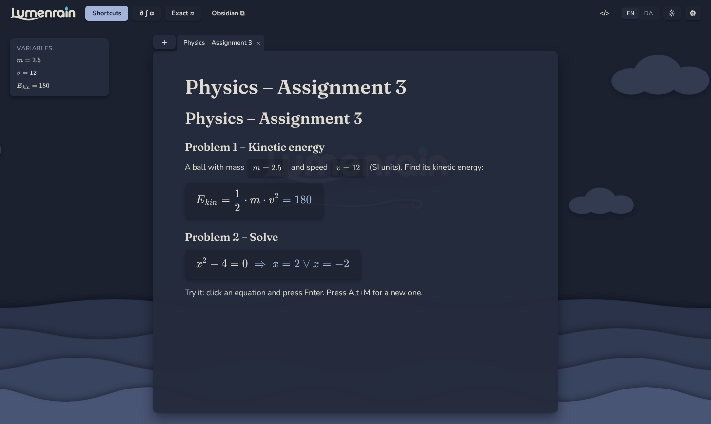
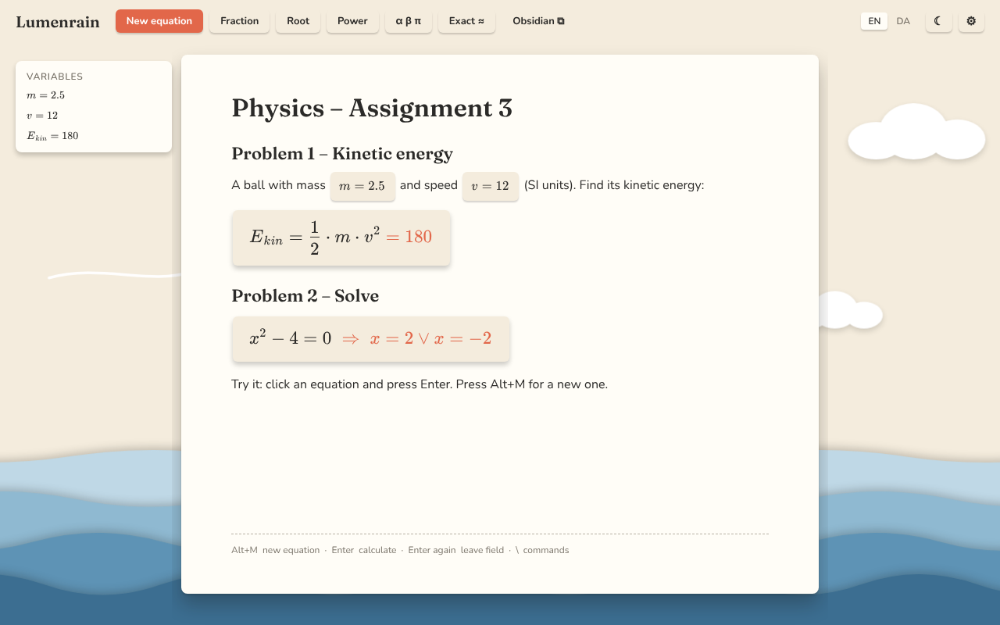

<p align="center">
  
</p>

<p align="center">
  
</p>

<p align="center"><b>Write maths like in Word. Calculate as you type. Save it to Obsidian.</b><br>
A calm, paper-cutout desktop notebook for engineering physics.</p>

<p align="center">
  <a href="https://github.com/Medi31K/LumenRain/releases/latest"><b>⬇ Download for Windows · macOS · Linux</b></a>
</p>

---

<p align="center">
  
  
</p>

## Features

### ✍️ Write like in Word
- **Notes with text and equation fields.** `Alt+M` inserts an equation on its own line, `Alt+Shift+M` one inside the text.
- **Live 2D maths with Word's build-up rules:**
  - `/` makes a fraction, `^` an exponent, `_` an index.
  - The denominator or exponent ends when you type an operator or a space: `1/2+1/3` → ½ + ⅓.
  - `sqrt(` opens a root and `)` closes it.
- **Word behaviour throughout:**
  - **Cursor:** ↑/↓ move between lines and into equations.
  - **Deleting:** the first Backspace selects an equation or fraction, the second deletes it.
  - **Undo:** Ctrl+Z / Ctrl+Y also covers equations.

### 🧮 Calculates as you write
- **Enter calculates** and the answer appears in the same field. Pressing Enter again leaves the field.
- **Exact and decimal:** `√2/3 + π = √2/3 + π ≈ 3.613`, `0.1 + 0.2 = 0.3`.
- **Solving:** `x² + 3x − 10 = 0 ⇒ x = 2 ∨ x = −5`.
- **Variables follow the note:** `m = 2.5`, `v = 12` → `E_kin = ½·m·v² = 180`.
- **Calculus:** `d/dx`, **∂/∂x**, higher-order derivatives, ∫ and ∫ₐᵇ, lim, Σ, Π, binomials and determinants, calculated symbolically.

### ⚛️ Built for engineering physics
Type a shortcut inside an equation:

| Type | Gives | | Type | Gives |
|---|---|---|---|---|
| `ddx` `ddt` | d/dx, d/dt | | `vec` `hat` | v⃗, x̂ |
| `pdx` `pdt` | ∂/∂x, ∂/∂t | | `grad` `div` `curl` `lap` | ∇, ∇·, ∇×, ∇² |
| `deriv` `pderiv` | d□/d□, ∂□/∂□ | | `tdot` `tddot` | ẋ, ẍ |
| `nderiv` `npderiv` | higher order | | `abs` `norm` | \|x\|, ‖x‖ |
| `int` `dint` | ∫ □ d□, ∫ₐᵇ | | `mat` `colv` `det` | matrix, column vector, det |
| `aint` `vint` `oint` | ∬ dA, ∭ dV, ∮ | | `bra` `ket` `bk` | ⟨ψ\|, \|ψ⟩, ⟨ψ\|φ⟩ |
| `lim` `sum` `prod` | lim, Σ, Π | | `alpha` … `Omega`, `hbar` | Greek letters, ħ |

There is also a palette with tabs (Calculus · Vectors & QM · Algebra · Relations · Greek) and a **Shortcuts** table in the toolbar.

### 📈 New in 0.2.0
- **Functions:** `f(x) = x² − 4`, then use `f(3)`, `f'(x)`, `∫₀¹ f(x) dx`, `h(x, y)` … anywhere below.
- **Graphs (Alt+G):** an interactive plot in the note, in the paper style.
  - It's filled from the current function, and you can add more curves.
  - Zeros, extrema and intersections are marked, and hovering shows the values.
  - Drag to move, scroll to zoom, double-click to fit.
  - It exports to Obsidian as an image.
- **Vectors & matrices:**
  - `v⃗ × w⃗` (cross), `v⃗ · w⃗` (dot), `‖v‖`, `a + 2b`
  - `A⁻¹`, `Aᵀ`, `det A`
  - Vector and matrix variables, shown as proper matrices
- **Command palette (Ctrl+P):** search every command, symbol and note.

### 🗂 Obsidian, without linking your vault
- **Export** a note as Markdown: inline equations become `$…$`, equations on their own line become `$$…$$`. Copy it or *Save as…* `.md`.
- **Import** Markdown back, including frontmatter, `---` lines and lists.
- **Templates:** *ROOT - NOTE* is built in. You can paste your own straight from Obsidian; `{{Title}}` and `{{date}}` are filled in.
- **Obsidian hotkeys**, all customisable. You can import your `.obsidian/hotkeys.json`:
  - Alt+1–6: headings
  - Ctrl+J / Ctrl+K: bullet / numbered list
  - Ctrl+E: Markdown source mode
- **Markdown while writing:** `# `, `- `, `1. ` and `---`.

### 🌊 Calm, tactile design
- **Paper-cutout theme in Day and Night,** with gently swaying waves, drifting clouds and passing wind. The scenery pauses while you type and respects "reduce motion".
- **Notes as tabs,** with a pinned **+** for new notes and templates.
- **English and Danish,** including decimal comma.

## Download

Get the installer for your system from **[Releases](https://github.com/Medi31K/LumenRain/releases/latest)**:

| System | File |
|---|---|
| **Windows** | `Lumenrain_x.y.z_x64-setup.exe` (or `.msi`) |
| **macOS** (Intel + Apple Silicon) | `Lumenrain_x.y.z_universal.dmg` |
| **Linux** | `.AppImage`, `.deb` or `.rpm` |

> The installers aren't code-signed yet. On Windows click **More info → Run anyway**. On macOS right-click the app and choose **Open** the first time.

## For developers

```bash
npm install          # installs everything in app/
npm run dev          # web preview at http://localhost:5173
npm test             # engine, calculus, Markdown and template tests
npm run tauri dev    # desktop window (needs Rust)
npm run tauri build  # local installer
```

On Windows the desktop build needs [Rust](https://rustup.rs) and [Microsoft C++ Build Tools](https://visualstudio.microsoft.com/visual-cpp-build-tools/) (*Desktop development with C++*).

**To make a release:**
1. Bump the version in `app/src-tauri/tauri.conf.json` and `app/package.json`.
2. Run **Actions → Release → Run workflow**, or push a tag `vX.Y.Z`.
3. Check the draft release and press *Publish*.

| Path | What |
|---|---|
| `app/src/engine.ts` | Calculation: evaluate, solve, variables, functions, vectors, calculus (Cortex Compute Engine) |
| `app/src/graph.ts`, `graphBlock.ts` | Graph analysis/rendering and the interactive graph block |
| `app/src/CommandPalette.tsx` | Ctrl+P palette |
| `app/src/editor.ts` | Word-style editor: equation fields, build-up rules, cursor, deletion, undo |
| `app/src/operators.ts` | Engineering-physics shortcuts and the symbol palette |
| `app/src/markdown.ts`, `templates.ts` | Obsidian Markdown, frontmatter and templates |
| `app/src/hotkeys.ts` | Customisable hotkeys (Obsidian format) |
| `app/src/Background.tsx`, `Splash.tsx` | Paper scenery and loading screen |
| `app/src-tauri/` | Desktop shell (Tauri 2) |
| `docs/` | Plan, design system, screenshots |

Design: [Figma](https://www.figma.com/design/5wj8aGzwvICBvt7NuCsowP)

## License

Copyright © 2026 Mehdi. **All rights reserved.** See [LICENSE](LICENSE). This is not open source.
